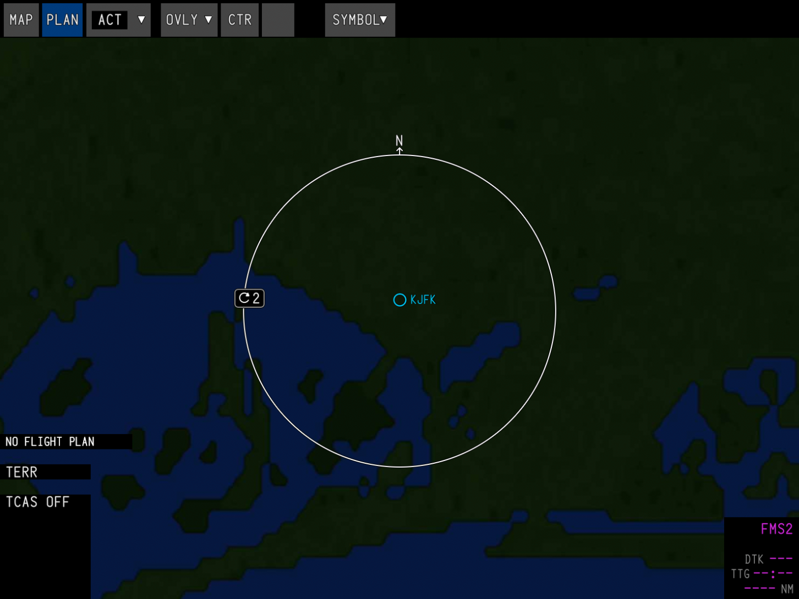
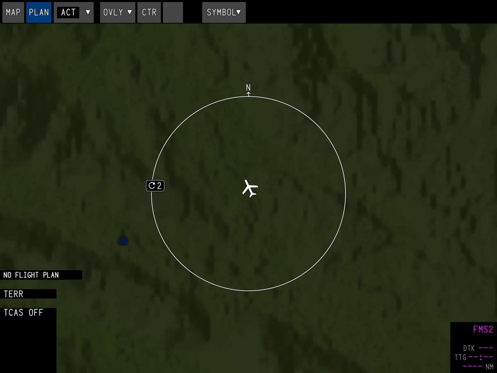
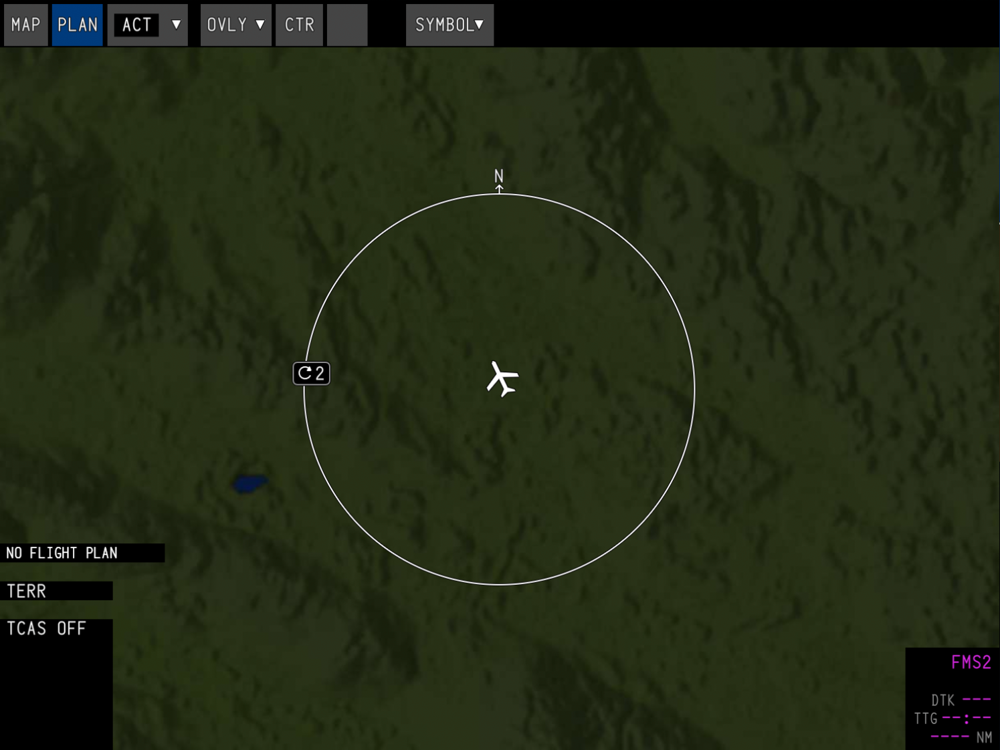

Terrain is the map server that draws the terrain on the navigation display. Due to simulator limitations, it runs as a separate program and sends the map images to the avionics over a WebSocket. It uses your integrated graphics, if you have them, and otherwise your main graphics card.

## Installation

<Steps>
    <Step>
        **Install the Synaptic Toolbox**

        Terrain is installed and run by the [Synaptic Toolbox](/pilots/toolbox). Download and install it first if you haven't already.
    </Step>
    <Step>
        **Install the Terrain service**

        Open the Toolbox from the Windows notification area and click **Install** next to **Terrain**. This downloads the map server and the Standard (400) resolution data, about 1.8 GB.

        Once installed, the High (1200) resolution data can optionally be downloaded from the [resolution](#resolutions) picker.
    </Step>
    <Step>
        **Load the A220**

        The terrain server automatically starts when the A220 is loaded, and stops when you switch aircraft or close the simulator. You can also start or stop it yourself with the button on the right of the Terrain card.
    </Step>
</Steps>

## Resolutions

At higher zoom levels, the map will look identical as it uses a lower LOD to reduce memory usage. The resolution only makes a noticeable difference when your range is set below 5 nautical miles.

<table>
    <thead>
        <tr>
            <th>Standard (400) — 1.8 GB</th>
            <th>High (1200) — 12.8 GB</th>
        </tr>
    </thead>
    <tbody>
        <tr>
            <td style={{ padding: 0 }}></td>
            <td style={{ padding: 0 }}></td>
        </tr>
        <tr>
            <td style={{ padding: 0 }}></td>
            <td style={{ padding: 0 }}></td>
        </tr>
    </tbody>
</table>
